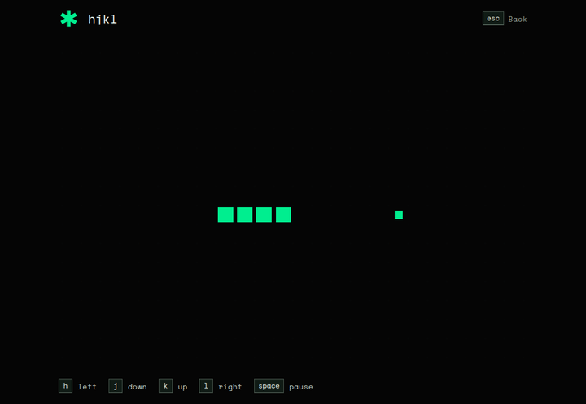

<p align="center">
  
</p>

<h1 align="center">hjkl</h1>

<p align="center">Learn Vim by doing: short editing challenges in a real browser Vim editor.<br>
<a href="https://hjkl.duy.run">hjkl.duy.run</a></p>

<p align="center">
  
</p>

## About

Pick the skills you want to learn. Each one has two guided edits, two prompted edits and two independent edits. An edit passes as soon as the text matches the goal, so any valid approach counts. Type `:help` in Normal mode for the current level's commands.

hjkl runs entirely in the browser, with no accounts or storage. It needs a physical keyboard and a screen at least 768 px wide.

## Development

Requires Node.js 22.13+.

```sh
npm ci
npm run dev -- --host localhost   # http://localhost:5173
npm run typecheck
npm test                          # needs: npx playwright install chromium webkit
```

Builds: `npm run build` (Cloudflare Workers), `npm run build:vercel`, or `npm run build:node` plus `node scripts/serve.mjs`. A `Containerfile` is included.

To add challenges, see [docs/content-authoring.md](docs/content-authoring.md). Lesson-flow rules are in [AGENTS.md](AGENTS.md).

## License

[MIT](LICENSE). Space Mono font under the SIL Open Font License.
